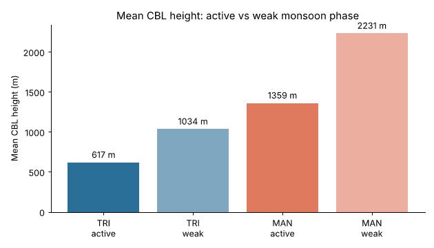
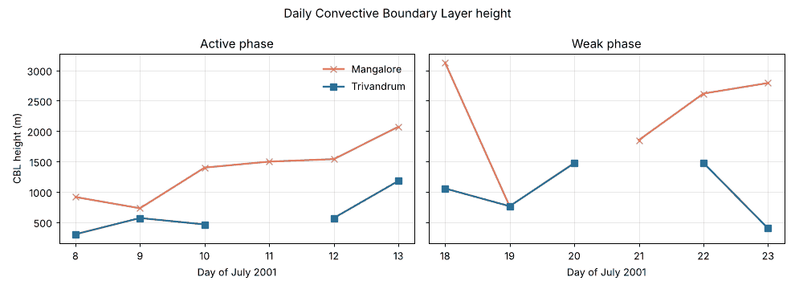

# Monsoon Boundary Layer Analysis

**How does the lowest layer of the atmosphere behave over two Indian coastal cities when the monsoon is strong versus when it stalls?** Radiosonde soundings from Trivandrum and Mangalore, July 2001, analysed with Conserved Variable Analysis.


📄 **Case study:** [sreejithmelepurath-byte.github.io/MYPORTFOLIO](https://sreejithmelepurath-byte.github.io/MYPORTFOLIO/)

---

## Key findings

| | Trivandrum | Mangalore |
|---|---|---|
| Mean CBL height, active phase | **617 m** | **1,359 m** |
| Mean CBL height, weak phase | **1,034 m** | **2,231 m** |
| Change, active → weak | **+67.6 %** | **+64.2 %** |
| LLJ core speed, active → weak | 38 → ~25 kt (−34 %) | 38 → ~20 kt (−47 %) |

- **Monsoon phase effect:** CBL height rises by roughly two-thirds at both stations once the monsoon breaks. With organised convection gone, stronger surface heating does the heavy lifting.
- **Terrain effect:** Mangalore's boundary layer runs about **2.2× deeper** than Trivandrum's in *both* phases, a steady contribution from the Western Ghats directly behind it.
- **Low-Level Jet:** the jet core weakens and rises in the break phase, cutting mechanical mixing near the surface.




## Method

1. **Data:** IMD radiosonde (RS/RW) ascents, 12 days: active spell 8–13 July 2001, weak spell 18–23 July 2001.
2. **Vertical profiles:** mixing ratio, wind speed, wind direction and virtual potential temperature (θv) per day.
3. **CBL height:** Conserved Variable Analysis, plotting equivalent potential temperature (θe) against mixing ratio (q) and reading the CBL top where the well-mixed line breaks.
4. **Statistics:** daily CBL heights averaged per station and phase; days with no clean θe–q reversal (3 of 24 station-days) are excluded rather than guessed.

## Reproduce

```bash
pip install -r requirements.txt
python src/analysis.py
```

Prints the summary tables above and regenerates the charts in `figures/`.

```
data/
├── cbl_heights.csv      # daily CBL height per station and phase
└── low_level_jet.csv    # LLJ core speed and height
src/analysis.py          # summary statistics + figures
figures/                 # generated charts
```

## Limitations

Six days per phase, one season, and three station-days without a usable CBL estimate. More seasons and stations would be needed to separate the phase and terrain effects with real statistical confidence. CBL heights are derived estimates from θe–q reversal points, not direct instrument readings.

---

By **Sreejith Sreenivasan (Sree)** · B.Sc. Physics research project · [Portfolio](https://sreejithmelepurath-byte.github.io/MYPORTFOLIO/)
